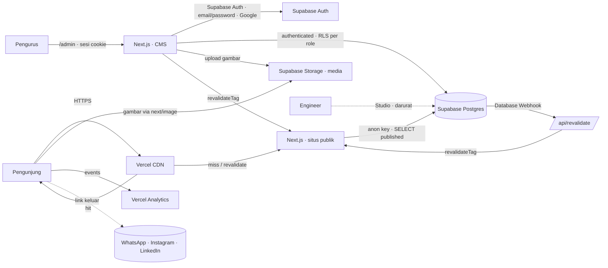
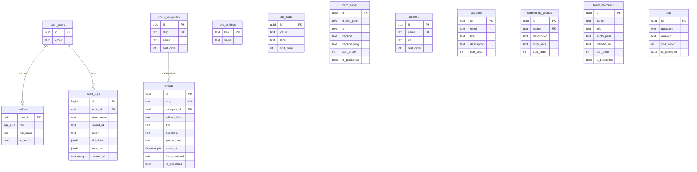
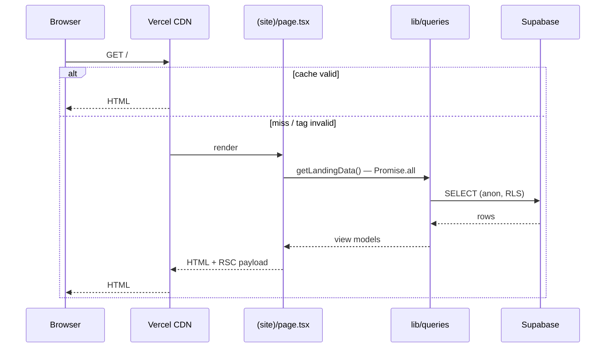
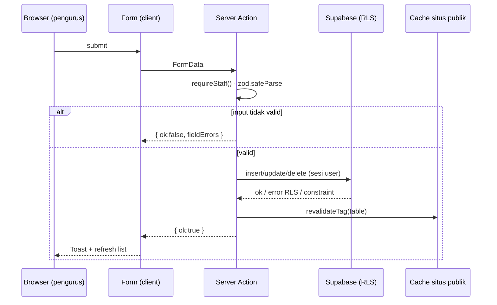

# ARCHITECTURE

| Atribut | Nilai |
|---------|-------|
| Status | v0.4 — 2026-11-23 (CMS `/admin` wajib sebelum launch; desain admin dari design-admin.md) |
| Stack | Next.js 15+ (App Router, TypeScript) · Tailwind CSS v4 · Supabase (Postgres, Auth, Storage) · Vercel |
| Dokumen terkait | [PRD](PRD.md) · [design-web](design/design-web.md) · [design-admin](design/design-admin.md) · [AGENTS](AGENTS.md) |

---

## 1. Keputusan Arsitektur

| # | Keputusan | Alasan | Konsekuensi |
|---|-----------|--------|-------------|
| AD-1 | Memakai **React Server Components** secara default | Hampir semua konten read-only, jadi JS di klien minim dan SEO bagus | Client Component hanya untuk MobileMenu, HeroSlider, Tabs webinar, Accordion, dan form/interaksi CMS |
| AD-2 | Halaman publik **statis + on-demand revalidation** (cache bertag) | Konten jarang berubah, sehingga halaman bisa disajikan dari CDN | Butuh `revalidateTag` dari webhook Supabase dan dari Server Action CMS |
| AD-3 | Supabase dipakai sebagai **backend konten**. Satu-satunya editor untuk pengurus adalah **CMS `/admin`**, sudah ada saat launch. Supabase Studio hanya untuk engineer (migrasi, darurat) | Pengurus bisa update konten tanpa deploy (G-4) tanpa akses langsung ke database | Validasi data di constraint DB, bukan hanya di form. CMS masuk jalur kritis launch |
| AD-4 | Kartu webinar menaut ke **Instagram**, tanpa halaman detail (sesuai Figma) | Menjaga MVP tetap kecil | Halaman detail + registrasi masuk Phase 2 (F-13) |
| AD-5 | Gambar disimpan di **Supabase Storage** (bucket `media`) dan ditampilkan lewat `next/image` | Pengurus bisa upload sendiri | `images.remotePatterns` diarahkan ke host Supabase |
| AD-6 | Visi & Misi (F-04) disimpan **di kode** (`src/content/about.ts`) | Kontennya statis dan jarang berubah | Perubahan dilakukan lewat PR, tidak ada modul CMS |
| AD-7 | Filter tab webinar dijalankan **di klien** atas data yang sudah dimuat | Jumlah datanya kecil (≤ 6) | `/webinar` memakai filter server via search param |
| AD-8 | Tidak memakai state library global | Tidak ada state yang dipakai lintas halaman | Cukup `useState` lokal + URL |
| AD-9 | **CMS custom** di route group `src/app/(admin)/admin`, satu aplikasi Next.js dengan situs publik | Satu repo, satu deploy, design token yang sama | Situs publik dan CMS dipisah lewat layout & klien Supabase yang berbeda (AD-10) |
| AD-10 | Situs publik memakai **klien anon tanpa cookie**. CMS memakai **klien cookie (`@supabase/ssr`)** | Halaman publik tetap statis/cached. CMS selalu dinamis dan per-user | Query publik dan query CMS dipisah (`lib/queries` vs `lib/queries/admin`) |
| AD-11 | **Otorisasi di-enforce oleh RLS** (role dari `profiles`). Cek role di Next.js hanya untuk UX & redirect | Server Action yang lupa cek role tetap aman | Setiap tabel butuh policy per role + pgTAP test |
| AD-12 | **Migrasi = sumber kebenaran skema**, satu file per domain, berurutan. Seed dipecah per tabel | Mudah di-review, `db reset` deterministik | Tidak memakai declarative schema / edit manual di Studio |
| AD-13 | **UI CMS mengikuti pola admin Albana Speech Academy** (Monochrome Soft), token terpisah `--admin-*` | Desain sudah teruji dan kodenya bisa di-port | Font & token admin hanya dimuat di route group `(admin)`; detail di [design/design-admin.md](design/design-admin.md) |

---

## 2. Arsitektur Sistem



### 2.1 Lingkungan

| Env | Vercel | Supabase |
|-----|--------|----------|
| local | `pnpm dev` | Supabase CLI (`supabase start`) + `supabase/seeds/*` |
| preview | Preview Deployment per PR | Project staging |
| production | Branch `main` | Project production |

### 2.2 Environment variables

| Variabel | Scope | Dipakai di |
|----------|-------|-----------|
| `NEXT_PUBLIC_SUPABASE_URL` | publik | `lib/supabase/*`, `next.config.ts` |
| `NEXT_PUBLIC_SUPABASE_ANON_KEY` | publik | `lib/supabase/server.ts`, `lib/supabase/server-auth.ts` |
| `REVALIDATE_SECRET` | server | `app/api/revalidate/route.ts` |
| `NEXT_PUBLIC_SITE_URL` | publik | `lib/seo.ts`, `sitemap.ts`, redirect URL auth |
| `SUPABASE_SERVICE_ROLE_KEY` | server | `lib/supabase/admin.ts` (hanya undang/nonaktifkan user) |

- Kredensial Google OAuth **tidak** masuk app. Disimpan di Supabase Dashboard (staging/prod) dan di env Supabase CLI lokal (`SUPABASE_AUTH_EXTERNAL_GOOGLE_CLIENT_ID`, `SUPABASE_AUTH_EXTERNAL_GOOGLE_SECRET`, dirujuk `config.toml`).
- Semua env app divalidasi dengan zod di `src/lib/env.ts`. Hanya `.env.example` yang boleh di-commit.

---

## 3. Struktur Folder

### 3.1 Aplikasi

```
.
├─ .github/                          # CI workflow (working-directory: project)
├─ .gitignore
├─ AGENTS.md                         # ringkasan instruksi agent (root)
├─ docs/                             # README · PRD · ARCHITECTURE · AGENTS · design/ (design-web, design-admin) · plan/
├─ supabase/                         # lihat §3.2 (bersama untuk frontend & backend tambahan)
└─ project/                          # aplikasi Next.js (Root Directory di Vercel)
   ├─ public/                        # ornaments/ · placeholders/ · logo-pci.svg · og-default.png
   ├─ src/
   │  ├─ proxy.ts                    # refresh sesi Supabase + guard /admin/* (Next 16)
   │  ├─ app/
   │  │  ├─ layout.tsx               # <html lang="id">, font DM Sans/Mono, globals.css
   │  │  ├─ globals.css              # token situs (design-web §7) + token `.admin-shell` (design-admin §2.5)
   │  │  ├─ (site)/                  # ── situs publik (statis) ──
   │  │  │  ├─ layout.tsx            # Analytics, SpeedInsights
   │  │  │  ├─ page.tsx              # landing: F-01…F-11
   │  │  │  └─ webinar/page.tsx      # F-07 (P1)
   │  │  ├─ (admin)/admin/           # ── CMS (dinamis, noindex) · lihat §9 ──
   │  │  ├─ api/revalidate/route.ts
   │  │  ├─ sitemap.ts · robots.ts   # F-12 (robots: disallow /admin)
   │  │  └─ not-found.tsx · error.tsx
   │  ├─ components/
   │  │  ├─ ui/                      # situs: C-03, C-05, C-06, C-07, C-08, C-19, C-22, C-26
   │  │  └─ layout/                  # C-01, C-02, C-04, container.tsx, section.tsx
   │  ├─ features/
   │  │  ├─ home/                    # C-10…C-14, C-17, C-18, C-24, C-25, faq-section
   │  │  ├─ webinar/                 # webinar-section, C-20, C-21, webinar-tabs (client)
   │  │  └─ admin/                   # modul CMS · lihat §9.4
   │  ├─ content/
   │  │  ├─ about.ts                 # Visi & Misi
   │  │  └─ fallback-links.ts        # link WA/IG/LinkedIn bila site_settings gagal
   │  └─ lib/
   │     ├─ supabase/
   │     │  ├─ server.ts             # anon, tanpa cookie → situs publik (cacheable)
   │     │  ├─ server-auth.ts        # @supabase/ssr, cookie sesi → CMS
   │     │  ├─ admin.ts              # service_role + `import "server-only"` → hanya modul Pengguna
   │     │  ├─ storage.ts            # publicUrl(path)
   │     │  └─ database.types.ts     # generated
   │     ├─ queries/                 # publik: satu file per domain, cache + tag
   │     │  └─ admin/                # CMS: tanpa cache, klien server-auth
   │     ├─ auth/                    # session.ts (requireStaff/requireAdmin) · permissions.ts
   │     ├─ env.ts · seo.ts · analytics.ts · utils.ts
   └─ tests/
      ├─ unit/                       # vitest
      └─ e2e/                        # playwright: site (360 & 1440) + admin
```

Aturan dependensi:
- `app → features → components → lib`. `components/ui` tidak boleh import dari `features` maupun `lib/queries`.
- `app/(site)` dan `features/{home,webinar}` **tidak boleh** import `lib/supabase/server-auth.ts`, `admin.ts`, `lib/auth`, atau `features/admin`. Ini menjaga halaman publik tetap statis.
- `lib/supabase/admin.ts` hanya boleh di-import oleh `features/admin/users/actions.ts`.

### 3.2 Database (`supabase/`)

```
supabase/
├─ config.toml                        # [auth] enable_signup=false · [auth.external.google] · [db.seed] sql_paths
├─ migrations/                        # <YYYYMMDDHHMMSS>_<domain>.sql · satu domain per file · append-only
│  ├─ 20261124000100_base.sql                  # extension, schema `private`, fungsi set_updated_at()
│  ├─ 20261124000200_site_settings_stats.sql   # T-01, T-02 + RLS + policy baca publik
│  ├─ 20261124000300_hero_slides.sql           # T-03
│  ├─ 20261124000400_home_content.sql          # T-04, T-05, T-06
│  ├─ 20261124000500_events.sql                # T-08, T-07 + index
│  ├─ 20261124000600_team_faqs.sql             # T-10, T-11
│  ├─ 20261124000700_storage_media.sql         # bucket media (public read, limit ukuran & MIME)
│  │  ── Fase CMS ──
│  ├─ <ts>_auth_roles_profiles.sql             # enum app_role, T-14 profiles, private.is_staff()/is_admin(), guard admin terakhir
│  ├─ <ts>_cms_write_policies.sql              # policy tulis editor/admin untuk T-01…T-11
│  ├─ <ts>_storage_media_write.sql             # policy upload/hapus objek media untuk staff
│  └─ <ts>_audit_logs.sql                      # T-15 + trigger private.log_change()
├─ seeds/                             # dijalankan berurutan oleh `pnpm db:reset`
│  ├─ 01_site_settings.sql · 02_site_stats.sql · 03_hero_slides.sql · 04_partners.sql
│  ├─ 05_activities.sql · 06_community_groups.sql · 07_event_categories.sql · 08_events.sql
│  ├─ 09_team_members.sql · 10_faqs.sql
│  └─ 90_local_dev_users.sql          # HANYA lokal: user test admin & editor (Fase CMS)
└─ tests/database/                    # pgTAP · `pnpm db:test` (= supabase test db)
   ├─ 01_schema_constraints.test.sql
   ├─ 02_rls_anon.test.sql
   ├─ 03_rls_editor.test.sql          # Fase CMS
   ├─ 04_rls_admin.test.sql           # Fase CMS
   └─ 05_storage_policies.test.sql    # Fase CMS
```

Aturan:
- **RLS diaktifkan di migrasi yang sama** dengan `create table`, bersama policy baca publiknya. Tidak ada jendela waktu tabel tanpa RLS.
- Isi tiap file domain berurutan: `create type` → `create table` (+ constraint) → index → trigger `set_updated_at` → `enable row level security` → policy → `comment on`.
- Migrasi yang sudah di-merge tidak boleh diedit. Perubahan = file baru.
- Seed idempoten (`insert … on conflict do nothing`) dan berisi copy Figma (PRD §5).
- `90_local_dev_users.sql` **tidak boleh** sampai ke staging/production. Jangan pernah `supabase db push --include-seed`. Seed konten production dijalankan manual per file `01`–`10`.

---

## 4. Skema Data

### 4.1 Konvensi

| Hal | Aturan |
|-----|--------|
| PK | `id uuid primary key default gen_random_uuid()`. Kecuali T-01 (`key text`) dan T-14 (`user_id`) |
| Audit kolom | `created_at timestamptz not null default now()`, `updated_at timestamptz not null default now()` + trigger `set_updated_at` |
| Urutan | `sort_order int not null default 0 check (sort_order >= 0)` |
| Publikasi | `is_published boolean not null default true` pada tabel yang bisa disembunyikan |
| Teks wajib | `not null check (char_length(btrim(col)) between 1 and <maks>)` |
| URL | `check (col ~ '^https://')`. Instagram: `check (col like 'https://www.instagram.com/%')` |
| Path storage | `check (col !~ '^/' and col !~ '\.\.')`, relatif terhadap bucket `media` |
| Slug | `check (slug ~ '^[a-z0-9]+(-[a-z0-9]+)*$')` + `unique` |
| FK | Konten → kategori `on delete restrict`. Ke `auth.users`: `profiles` `on delete cascade`, `audit_logs` `on delete set null` |
| Fungsi | `security definer` hanya di schema `private` (tidak diekspos PostgREST), selalu `set search_path = ''` |

### 4.2 ERD



Tabel konten (T-01 – T-11) tidak punya relasi ke `auth.users`. Siapa mengubah apa dicatat di `audit_logs` (T-15), sehingga tabel konten tetap sederhana.

### 4.3 Katalog tabel

| ID | Tabel | Fitur | Kolom & constraint penting | Seed (Figma) |
|----|-------|-------|---------------------------|--------------|
| T-01 | `site_settings` | F-01, F-02, F-06, F-09, F-11, F-18 | PK `key` `check (key in ('whatsapp_url','instagram_url','instagram_handle','linkedin_url'))`; `value text not null`; URL key wajib `^https://` (check bersyarat) | 4 baris (URL: PRD Q-1) |
| T-02 | `site_stats` | F-02, F-17 | `value text` ("8+", maks 8), `label text` ("webinar sejak Mei 2025", maks 60) | 2 baris |
| T-03 | `hero_slides` | F-02, F-17 | `image_path`, `alt` not null; `caption` (pendek, maks 40); `caption_long` nullable (maks 80, tablet) | 4 baris; slide 1 "PCI × IPC 2026" / "PCI × INDONESIA PRODUCT CONFERENCE 2026" |
| T-04 | `partners` | F-03, F-17 | `name` not null unique (maks 60), `url` nullable `^https://` | Riung Connect, Indonesia Product Conference, Bisain., Coptera, rubythalib.ai |
| T-05 | `activities` | F-05, F-17 | `emoji text not null check (char_length(emoji) <= 8)`; `title` maks 60; `description` maks 200 | 4 baris (PRD F-05) |
| T-06 | `community_groups` | F-05, F-17 | `name` unique; `logo_path` not null | Job Akses, Akses Belajar, Bagi-Bagi Project, Forum Jual Beli |
| T-07 | `events` | F-06, F-07, F-17 | `slug` unique; `category_id` FK `on delete restrict`; `edition_label` ("#SharingSession7", maks 40); `title` maks 140; `speakers` text (baris tampilan "Nama · Peran", maks 200); `poster_path` not null (1:1); `starts_at timestamptz not null`; `instagram_url` Instagram check; index `(is_published, starts_at desc)` | 6 baris (PRD F-06) |
| T-08 | `event_categories` | F-06, F-07, F-17 | `slug` unique, `name` maks 40 | `sharing-session` "Sharing Session", `riung-class` "Riung Class" |
| T-09 | ~~`event_speakers`~~ | — | **(deprecated)**: diganti kolom `events.speakers`, karena Figma hanya menampilkan satu baris teks | — |
| T-10 | `team_members` | F-08, F-17 | `name` maks 60, `role` maks 60; `photo_path` not null; `linkedin_url` nullable `^https://` | 4 pengurus (PRD F-08) |
| T-11 | `faqs` | F-10, F-12, F-17 | `question` maks 160; `answer` plain text maks 1000 | 4 baris (PRD F-10) |
| T-14 | `profiles` | F-16, F-19 | PK `user_id` FK `auth.users(id) on delete cascade`; `role app_role not null` (`'admin'`,`'editor'`); `full_name` maks 80; `is_active bool not null default true`; trigger `private.guard_last_admin()` menolak demote/nonaktif/hapus admin aktif terakhir | lokal: 1 admin + 1 editor test (`90_local_dev_users.sql`). Prod: admin pertama di-bootstrap manual (plan Fase 12) |
| T-15 | `audit_logs` | F-19 | `id bigint generated always as identity`; `actor_id` FK `auth.users on delete set null` (diisi `auth.uid()`); `table_name`, `record_id text`, `action text check (action in ('insert','update','delete'))`, `old_data`/`new_data jsonb`; index `(created_at desc)`, `(table_name, record_id)`. Append-only | — |

Aturan turunan:
- "Webinar berikutnya" (C-20) adalah event published dengan `starts_at > now()` yang paling awal. Jika tidak ada, tampilkan fallback statis.
- Format tanggal kartu adalah `Intl.DateTimeFormat('id-ID', { weekday:'long', day:'numeric', month:'short', year:'numeric', timeZone:'Asia/Jakarta' })`, hasilnya mis. "Rabu, 4 Nov 2026".
- Input `starts_at` di CMS memakai zona `Asia/Jakarta` dan disimpan sebagai `timestamptz`.

### 4.4 Fungsi & trigger

| Fungsi | Schema | Jenis | Dipakai |
|--------|--------|-------|---------|
| `set_updated_at()` | `private` | trigger `before update` | semua tabel kecuali T-15 |
| `current_app_role()` | `private` | `stable security definer` → `app_role` dari `profiles` aktif milik `auth.uid()`, atau `null` | helper |
| `is_staff()` | `private` | `stable security definer` → `current_app_role() is not null` | policy RLS & storage |
| `is_admin()` | `private` | `stable security definer` → `current_app_role() = 'admin'` | policy RLS |
| `guard_last_admin()` | `private` | trigger `before update or delete` pada T-14 | cegah CMS terkunci tanpa admin |
| `log_change()` | `private` | trigger `after insert/update/delete` (`security definer`) pada T-01 – T-11, T-14 | tulis T-15 |

```sql
-- pola helper (Fase CMS)
create function private.current_app_role() returns public.app_role
language sql stable security definer set search_path = ''
as $$
  select p.role from public.profiles p
  where p.user_id = (select auth.uid()) and p.is_active
$$;

grant usage on schema private to authenticated;
revoke execute on all functions in schema private from public, anon;
grant execute on function private.is_staff(), private.is_admin() to authenticated;
```

### 4.5 Storage

| Bucket | Akses | Batas | Path |
|--------|-------|-------|------|
| `media` | public read. Tulis: staff via CMS (Server Action) | `file_size_limit` 2 MB; MIME `image/webp`, `image/png`, `image/jpeg` (SVG ditolak karena risiko XSS) | `hero/`, `events/`, `groups/`, `team/` + `<uuid>.<ext>` |

- Kolom `*_path` menyimpan path relatif terhadap bucket. URL publik dibangun oleh `lib/supabase/storage.ts#publicUrl(path)`.
- Nama file dibuat server (`crypto.randomUUID()`), bukan dari nama file user. Mengganti gambar = upload objek baru, update kolom, lalu hapus objek lama (cache CDN tidak basi).

### 4.6 Phase 2

Tabel dan kolom di bawah ini **belum boleh dibuat** sampai F-13/F-14 disetujui dan desainnya tersedia.

| ID | Perubahan | Fitur |
|----|-----------|-------|
| T-07+ | `events` + `registration_mode` enum (`external`,`internal`,`none`), `registration_url`, `capacity`, `description` | F-13 |
| T-12 | `event_registrations` (`event_id` FK, `full_name`, `email citext`, `whatsapp`, `occupation`, `organization`, `consent_at`; `unique(event_id, email)`) | F-13 |
| T-13 | `newsletter_subscribers` (`email citext unique`, `source`, `status` enum, `unsubscribe_token`) | F-14 |

Penulisan publik dilakukan oleh Server Actions dengan klien `service_role` (`lib/supabase/admin.ts`), validasi zod, honeypot, dan rate limit. Hasilnya bertipe `ActionResult = { ok: true } | { ok: false; code; fieldErrors? }`. Data T-12/T-13 dibaca di CMS hanya oleh `admin` (modul ditambah saat Phase 2).

---

## 5. Keamanan

### 5.1 Matriks RLS

`anon` = situs publik. `editor`/`admin` = role `authenticated` dengan `private.is_staff()` / `private.is_admin()`. User login tanpa baris `profiles` aktif tidak dapat akses apa pun.

| Tabel | anon SELECT | staff SELECT | editor INSERT/UPDATE/DELETE | admin INSERT/UPDATE/DELETE |
|-------|-------------|--------------|-----------------------------|----------------------------|
| T-01 `site_settings` | semua | semua | — | UPDATE (key tetap, tidak ada insert/delete dari CMS) |
| T-02 `site_stats` | semua | semua | ✔ | ✔ |
| T-03 `hero_slides` | `is_published` | semua | ✔ | ✔ |
| T-04 `partners`, T-05 `activities`, T-06 `community_groups` | semua | semua | ✔ | ✔ |
| T-07 `events` | `is_published` | semua | ✔ | ✔ |
| T-08 `event_categories` | semua | semua | — | ✔ (delete gagal bila masih dipakai, FK restrict) |
| T-10 `team_members`, T-11 `faqs` | `is_published` | semua | ✔ | ✔ |
| T-14 `profiles` | — | baris sendiri; admin semua | — | ✔ lewat modul Pengguna (+ guard admin terakhir) |
| T-15 `audit_logs` | — | admin saja | — (ditulis trigger) | — (append-only) |
| `storage.objects` bucket `media` | baca publik | — | upload/update/delete di folder §4.5 | sama |

Contoh policy:

```sql
create policy events_select_public on public.events
  for select to anon using (is_published);
create policy events_select_staff on public.events
  for select to authenticated using ((select private.is_staff()));
create policy events_write_staff on public.events
  for all to authenticated
  using ((select private.is_staff())) with check ((select private.is_staff()));
```

### 5.2 Aturan

- RLS **aktif di semua tabel**, dan tidak ada policy tulis untuk `anon`.
- `service_role` hanya ada di `lib/supabase/admin.ts` (`import "server-only"`) untuk `auth.admin.inviteUserByEmail` dan menonaktifkan user. Semua mutasi konten memakai klien sesi user, jadi RLS tetap berlaku.
- Auth CMS:
  - Signup publik dimatikan (`enable_signup = false`). Akun hanya lewat undangan admin.
  - Metode: email + password, dan Google OAuth (PKCE). Login Google hanya berhasil untuk email yang sudah diundang (identitas di-link otomatis ke user yang ada).
  - Password minimal 10 karakter. Rate limit bawaan Supabase Auth aktif.
  - Redirect URL yang diizinkan: `${NEXT_PUBLIC_SITE_URL}/admin/auth/callback` dan `/admin/auth/confirm` per environment.
- `/admin/*` selalu `noindex` (metadata + `robots.ts`) dan `Cache-Control: private, no-store`.
- `/api/revalidate`:
  - Hanya menerima `POST`.
  - Header `x-revalidate-secret` dibandingkan dengan `timingSafeEqual`.
  - Body `{ table }` divalidasi zod terhadap daftar tabel yang dikenal.
- Header keamanan diatur di `next.config.ts`:
  - CSP: `img-src` mengizinkan host Supabase; `connect-src` mengizinkan Supabase (Auth CMS) dan Vercel Insights; `frame-ancestors 'none'`.
  - `X-Content-Type-Options: nosniff`.
  - `Referrer-Policy: strict-origin-when-cross-origin`.
- Semua link keluar memakai `rel="noopener noreferrer"`.

---

## 6. Data Flow

### 6.1 Render landing



- Query non-kritis (partners, slides) yang gagal: section disembunyikan dan error di-log; halaman tetap tampil.
- Query `site_settings` yang gagal memakai fallback dari `src/content/fallback-links.ts`, supaya CTA WhatsApp tidak pernah mati.

### 6.2 Update konten

Pengurus mengubah konten lewat CMS:




Jaring pengaman untuk perubahan di luar CMS (migrasi, seed, perbaikan darurat oleh engineer lewat Studio): Database Webhook (`insert/update/delete` pada T-01 – T-11) → `POST /api/revalidate` `{ table }` → `revalidateTag(table)`. Fallback terakhir `export const revalidate = 3600`.

### 6.3 Autentikasi CMS

1. `GET /admin/*` → `proxy.ts` me-refresh sesi. Tanpa sesi → redirect `/admin/login?next=<path>`.
2. Login email + password (`signInWithPassword`) atau Google (`signInWithOAuth` → `/admin/auth/callback` → `exchangeCodeForSession`).
3. Undangan & reset password: link email → `/admin/auth/confirm?token_hash&type` → `verifyOtp` → `/admin/reset-password` untuk set password.
4. Layout `(cms)` memanggil `requireStaff()`. Sesi ada tapi tanpa `profiles` aktif → sign out + pesan "Akun kamu belum punya akses CMS".
5. Halaman khusus admin memanggil `requireAdmin()` → `notFound()` untuk editor.

### 6.4 Interaksi klien

| Interaksi | Komponen | State |
|-----------|----------|-------|
| Buka/tutup menu | C-02 | `useState`, scroll-lock body, focus trap |
| Ganti slide | C-12 | Index lokal; swipe via pointer events; tanpa library |
| Ganti tab webinar | C-19 + C-21 | Kategori aktif lokal; filter array dari props |
| Buka/tutup FAQ | C-26 | `<details>`/`<summary>` native atau state lokal |
| Klik CTA | C-05 | `track('cta_click', …)` dari `lib/analytics.ts` |
| Form CMS | C-35 FormDialog / C-36 FormPage + Server Action | `useTransition`; error per field dari zod (`ActionResult.fieldErrors`) |
| Urutkan item CMS | C-31 SortButtons | Tombol ↑ ↓ → Server Action `move<Entity>` (tukar `sort_order` dengan tetangga) |

---

## 7. Kontrak Data-Akses

### 7.1 Publik (`src/lib/queries`)

| Fungsi | Return (view model) | Tag | Fitur |
|--------|--------------------|-----|-------|
| `getSiteLinks()` | `{ whatsappUrl, instagramUrl, instagramHandle, linkedinUrl }` | `site_settings` | F-01, F-02, F-06, F-09, F-11 |
| `getHeroData()` | `{ stats: Stat[]; slides: Slide[] }` | `site_stats`, `hero_slides` | F-02 |
| `getPartners()` | `Partner[]` | `partners` | F-03 |
| `getActivities()` | `Activity[]` | `activities` | F-05 |
| `getCommunityGroups()` | `CommunityGroup[]` | `community_groups` | F-05 |
| `getWebinarSection()` | `{ categories; events: WebinarCardData[] (≤6); next: WebinarCardData \| null }` | `events`, `event_categories` | F-06 |
| `getWebinarArchive({ category?, page })` | `{ items; totalPages }` | `events`, `event_categories` | F-07 |
| `getTeamMembers()` | `TeamMember[]` | `team_members` | F-08 |
| `getFaqs()` | `Faq[]` | `faqs` | F-10, F-12 |

`getLandingData()` menggabungkan semua fungsi di atas dengan `Promise.all`. Komponen menerima view model, bukan row DB mentah. Pemetaan row ke view model dilakukan di `lib/queries/*` dan diuji unit.

### 7.2 CMS (`src/lib/queries/admin`, Fase CMS)

- Memakai `lib/supabase/server-auth.ts`, **tanpa cache**, dan mengembalikan semua baris (termasuk unpublished) sesuai RLS.
- Satu file per modul: `list<Entity>()`, `get<Entity>(id)`. Contoh: `listEvents({ category?, status?, page })`, `getEvent(id)`, `listAuditLogs({ table?, page })`.
- Mutasi ada di `features/admin/<modul>/actions.ts` (Server Action), bukan di `lib/queries`.

---

## 8. Kualitas & Deploy

| Aspek | Standar |
|-------|---------|
| Package manager | pnpm |
| Lint/format | ESLint (`next/core-web-vitals`, `typescript-eslint` strict) + Prettier (`prettier-plugin-tailwindcss`) |
| TS | `strict`, `noUncheckedIndexedAccess` |
| Test | Vitest (mapper, format tanggal, schema env, schema zod CMS, `can()`) · pgTAP (constraint, RLS per role, storage) · Playwright (UF-1 – UF-5, viewport 390 & 1440) · `@axe-core/playwright` |
| CI | GitHub Actions: lint → typecheck → unit → `supabase db reset` + `supabase test db` → build → e2e terhadap preview |
| Migrasi | `supabase db push` ke staging lewat CI. Production manual setelah review |
| Monitoring | Vercel Analytics + Speed Insights |

---

## 9. CMS (`/admin`)

Fitur PRD: F-16 – F-19. Tampilan, token, templat, dan komponen C-28 – C-40: [design/design-admin.md](design/design-admin.md). CMS wajib ada sebelum launch (AD-3).

### 9.1 Role

| Role | Untuk | Ringkas |
|------|-------|---------|
| `admin` | Ketua / pengelola teknis pengurus | Semua modul, termasuk Pengaturan, Pengguna, Log Aktivitas, Kategori Webinar |
| `editor` | Pengurus lain | Kelola konten (Beranda, Webinar). Tidak bisa ubah pengaturan, kategori, user, atau melihat log |

### 9.2 Navigasi & hierarki

Sidebar dikelompokkan. Item yang tidak boleh diakses role saat ini **tidak ditampilkan**. Sumber tunggal: `features/admin/shell/nav.ts` (`NAV_GROUPS`, tiap item punya `roles`).

```
Header (C-28):  logo "PCI CMS" → /admin · toggle tema · menu akun: Akun Saya (/admin/account) · Lihat Situs ↗ · Keluar (POST /admin/auth/signout)

Sidebar (C-29):
Dashboard                         /admin
Konten Beranda
  ├─ Hero (Slide · Statistik)     /admin/hero            F-02 · T-02, T-03
  ├─ Kolaborasi                   /admin/partners        F-03 · T-04
  ├─ Kegiatan                     /admin/activities      F-05 · T-05
  ├─ Grup Komunitas               /admin/groups          F-05 · T-06
  ├─ Pengurus                     /admin/team            F-08 · T-10
  └─ FAQ                          /admin/faqs            F-10 · T-11
Webinar
  ├─ Semua Webinar                /admin/events          F-06, F-07 · T-07
  │   ├─ Tambah                   /admin/events/new
  │   └─ Edit                     /admin/events/[id]
  └─ Kategori            (admin)  /admin/event-categories F-06 · T-08
Pengaturan               (admin)
  ├─ Link & Sosial Media          /admin/settings        F-01, F-09, F-11 · T-01
  ├─ Pengguna                     /admin/users           F-19 · T-14
  └─ Log Aktivitas                /admin/audit-log       F-19 · T-15
```

Kode `NAV_GROUPS` lengkap (label, ikon, deskripsi kepala halaman, `roles`): [design-admin §3.2](design/design-admin.md#32-sidebar-c-29).

Halaman tanpa sidebar: `/admin/login`, `/admin/forgot-password`, `/admin/reset-password`.

### 9.3 Matriks izin

`R` baca · `C` buat · `U` ubah · `D` hapus · `O` urutkan · `P` publish/unpublish · — tidak ada akses (menu disembunyikan, route `notFound()`).

| Modul | Data | editor | admin | Catatan |
|-------|------|--------|-------|---------|
| Dashboard | ringkasan | R | R | Admin juga melihat 10 log terakhir |
| Hero · Slide | T-03 | R C U D O P | R C U D O P | Upload gambar (C-32) |
| Hero · Statistik | T-02 | R C U D O | R C U D O | Maks 4 item (cek di zod) |
| Kolaborasi | T-04 | R C U D O | R C U D O | |
| Kegiatan | T-05 | R C U D O | R C U D O | |
| Grup Komunitas | T-06 | R C U D O | R C U D O | Upload logo |
| Pengurus | T-10 | R C U D O P | R C U D O P | Upload foto |
| FAQ | T-11 | R C U D O P | R C U D O P | |
| Webinar | T-07 | R C U D P | R C U D P | Urutan dari `starts_at`, bukan `sort_order` |
| Kategori Webinar | T-08 | — | R C U D O | Hapus ditolak bila masih dipakai |
| Link & Sosial Media | T-01 | — | R U | 4 key tetap |
| Pengguna | T-14 + Auth | — | R C U D | C = undang email + role. U = ganti role / aktif-nonaktif. D = nonaktifkan + `auth.admin.deleteUser`. Tidak bisa menurunkan diri sendiri bila admin terakhir |
| Log Aktivitas | T-15 | — | R | Filter tabel & user, read-only |
| Akun Saya | sesi sendiri | R U | R U | Ganti nama & password, hubungkan Google |

Matriks ini diterjemahkan 1:1 ke `lib/auth/permissions.ts` (`can(role, module, action)`) untuk UI, dan ke RLS (§5.1) untuk enforcement.

### 9.4 Struktur folder CMS

```
src/app/(admin)/admin/
├─ layout.tsx                    # font Plus Jakarta Sans (--font-admin), .admin-shell, metadata noindex, <Toaster/> (sonner)
├─ (auth)/                       # layout polos, kartu tengah
│  ├─ login/page.tsx             # email+password + tombol Google
│  ├─ forgot-password/page.tsx
│  └─ reset-password/page.tsx
├─ auth/
│  ├─ callback/route.ts          # OAuth PKCE: exchangeCodeForSession → redirect `next`
│  ├─ confirm/route.ts           # verifyOtp(token_hash, type) untuk invite & recovery
│  └─ signout/route.ts           # POST
└─ (cms)/                        # layout: requireStaff() + AdminShell (C-28); tiap modul punya loading.tsx (skeleton) & error.tsx
   ├─ page.tsx                   # Dashboard
   ├─ hero/page.tsx              # tab Slide · Statistik
   ├─ partners/page.tsx
   ├─ activities/page.tsx
   ├─ groups/page.tsx
   ├─ team/page.tsx
   ├─ faqs/page.tsx
   ├─ events/page.tsx · events/new/page.tsx · events/[id]/page.tsx
   ├─ event-categories/page.tsx  # requireAdmin()
   ├─ settings/page.tsx          # requireAdmin()
   ├─ users/page.tsx             # requireAdmin()
   ├─ audit-log/page.tsx         # requireAdmin()
   └─ account/page.tsx

src/features/admin/
├─ shell/        admin-shell.tsx (C-28) · admin-sidebar.tsx (C-29) · page-header.tsx (C-40) · nav.ts
├─ ui/           data-table.tsx (C-30) · sort-buttons.tsx (C-31) · image-upload.tsx (C-32)
│                delete-dialog.tsx (C-33) · table-toolbar.tsx (C-34) · admin-sheet.tsx (C-35)
│                empty-state.tsx (C-38) · row-actions.tsx (C-39)
│                action-result.ts (ActionResult, fail, fromZod) · storage.ts (uploadImage, removeImage; server)
│                sort.ts (nextSortOrder) · skeleton.tsx
│  └─ form/      form-dialog.tsx (C-35) · fields.tsx (C-36) · controls.tsx (C-37)
├─ auth/         login-form.tsx · google-button.tsx · actions.ts · schema.ts
├─ dashboard/    dashboard-stats.tsx · recent-activity.tsx
└─ <modul>/      hero · partners · activities · groups · team · faqs · events
                 event-categories · settings · users · audit-log · account
   ├─ <modul>-manager.tsx        # client: toolbar + tabel/kartu + dialog (CRUD satu halaman, design-admin §12)
   ├─ <modul>-form.tsx           # hanya modul T2 (Webinar, Pengaturan, Akun)
   ├─ actions.ts                 # "use server": create/update/remove/reorder/togglePublish
   └─ schema.ts                  # zod, dipakai form (client) dan action (server)

src/lib/
├─ auth/session.ts               # getStaff() (cached per request), requireStaff(), requireAdmin()
├─ auth/permissions.ts           # ROLE_PERMISSIONS + can()
└─ queries/admin/<modul>.ts      # list/get untuk CMS (§7.2)
```

### 9.5 Pola Server Action

```ts
"use server";
// features/admin/ui/action-result.ts
export type ActionResult =
  | { ok: true }
  | { ok: false; code: "invalid" | "conflict" | "forbidden" | "error"; message: string; fieldErrors?: Record<string, string> };

// features/admin/faqs/actions.ts
export async function saveFaq(formData: FormData): Promise<ActionResult> {
  await requireStaff();                                   // UX guard; RLS tetap enforce
  const parsed = faqSchema.safeParse(Object.fromEntries(formData));
  if (!parsed.success) return fromZod(parsed.error);     // fieldErrors: pesan pertama per field
  const supabase = await createServerAuthClient();
  const { error } = await supabase.from("faqs").update(parsed.data).eq("id", parsed.data.id);
  if (error) return fail(error);                          // 23505 unique, 23503 FK, 23514 check, 42501 RLS → pesan Indonesia
  revalidateTag("faqs");
  return { ok: true };
}
```

- Satu action = satu tabel = satu `revalidateTag` (Next 16: `updateTag(tag)` di Server Action agar perubahan langsung terbaca).
- Contoh lengkap CRUD satu halaman (FAQ, Pengurus, Link & Sosial): [design-admin §12](design/design-admin.md#12-sampel-crud-satu-halaman).
- Hapus selalu lewat C-33 DeleteDialog. Tidak ada soft delete; jejak ada di `audit_logs`.
- Hapus baris yang punya gambar juga menghapus objek storage-nya (setelah baris berhasil dihapus).
