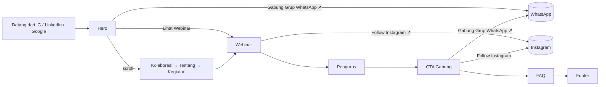

# PRD — Product Requirements Document

| Atribut | Nilai |
|---------|-------|
| Produk | Website Product Community Indonesia (PCI) |
| Status | v0.4 — 2026-11-23 (CMS `/admin` wajib sebelum launch; Studio tidak dipakai pengurus) |
| Sumber desain | Figma `SHwk8txsKDV19XXgaBqiGk`, section `1:23` "PCI Website · MVP Komunitas" |
| Frame | Desktop 1440 (`1:24`) · Tablet 768 (`1:288`) · Mobile 390 (`1:550`) · Mobile Menu Open (`1:781`) |
| Dokumen terkait | [design-web](design/design-web.md) · [design-admin](design/design-admin.md) · [ARCHITECTURE](ARCHITECTURE.md) · [AGENTS](AGENTS.md) |

Copy di dokumen ini diambil langsung dari layer teks Figma. Copy di Figma adalah copy final kecuali ditandai lain.

---

## 1. Ringkasan Produk

PCI adalah komunitas *product people* Indonesia: PM, PO, product analyst, designer, engineer, mahasiswa, dan career switcher. Website ini menjadi **pintu masuk komunitas**. Pengunjung bisa mengenal PCI, melihat kegiatan dan arsip webinar, lalu bergabung lewat Grup WhatsApp atau Instagram.

- Tagline: **"Step by step, sampai idenya nyala"** 💡
- Headline: **"Belajar & Bertumbuh Bersama Komunitas Product Indonesia"**

### 1.1 Tujuan

| ID | Tujuan | Metrik |
|----|--------|--------|
| G-1 | Mengubah pengunjung menjadi anggota | Rasio klik CTA "Gabung Grup WhatsApp" per sesi (target awal ≥ 8%) |
| G-2 | Menunjukkan bahwa komunitas aktif dan kredibel | Scroll depth ≥ 50% pada ≥ 40% sesi |
| G-3 | Menjadi arsip dan kanal promosi webinar | Klik "Lihat di IG" dan klik tab webinar |
| G-4 | Konten bisa dirawat pengurus non-engineer | Update konten tanpa deploy ulang |

### 1.2 Non-Goals (MVP)

- Login member, forum di website, pembayaran, tiket, sertifikat.
- Halaman detail webinar. Di desain, kartu webinar menautkan ke post Instagram.
- Form registrasi dan newsletter. Keduanya masuk Phase 2 dan belum ada desainnya.

---

## 2. Persona & Kebutuhan

| ID | Persona | Kebutuhan | Fitur |
|----|---------|-----------|-------|
| P-1 | **Aspiring PM / Career Switcher** (mahasiswa, pindah karier) | Paham PCI, tahu cara mulai, yakin komunitasnya terbuka | F-02, F-04, F-05, F-10 |
| P-2 | **Practitioner** (PM/Designer/Engineer 1–5 thn) | Lihat topik webinar, info lowongan & project, networking | F-05, F-06 |
| P-3 | **Speaker / Partner** | Bukti kredibilitas dan jangkauan komunitas | F-02 (stats, slider), F-03, F-08 |
| P-4 | **Pengurus (admin konten)** | Update webinar, FAQ, statistik tanpa engineer | F-16 – F-19: CMS `/admin` (role `admin`/`editor`). Pengurus **tidak** memakai Supabase Studio |

---

## 3. Information Architecture

```
/                     Landing page (single page)
 ├─ #tentang          F-04 Tentang
 ├─ #kegiatan         F-05 Kegiatan & Grup
 ├─ #webinar          F-06 Webinar
 ├─ #pengurus         F-08 Pengurus
 └─ #faq              F-10 FAQ
/webinar              F-07 Arsip semua webinar (P1, belum ada desain, susun dari komponen yang ada)
/admin                F-16 – F-19 CMS (Fase CMS, noindex). Hierarki menu: ARCHITECTURE §9.2
```

Navbar: **Tentang · Kegiatan · Webinar · FAQ** + tombol **Gabung Komunitas**. Section Pengurus tidak ada di navbar.

Link eksternal (disimpan di `site_settings`):
- `whatsapp_url`: grup WhatsApp komunitas.
- `instagram_url`: `@productcommunityid`.
- `linkedin_url`: halaman LinkedIn PCI.

---

## 4. User Flows

### UF-1 — Pengunjung baru bergabung (G-1)



### UF-2 — Menjelajah webinar (G-3)

1. Buka section Webinar (dari navbar, tombol "Lihat Webinar", atau scroll).
2. Pilih tab **Semua / Sharing Session / Riung Class**. Grid langsung terfilter di klien.
3. Baca kartu: poster, edisi, judul, pembicara, tanggal.
4. Klik **"Lihat di IG ↗"** untuk membuka post Instagram webinar di tab baru.
5. Klik **"Lihat semua webinar"** untuk membuka `/webinar` (P1).
6. Jika belum ada webinar mendatang, banner "WEBINAR BERIKUTNYA" menampilkan "Lagi disiapin, pantengin terus ya!" dan tombol **Follow Instagram ↗**.

### UF-3 — Navigasi mobile/tablet (≤ 1023px)

1. Tap ikon hamburger di navbar. Menu fullscreen terbuka (frame `1:781`).
2. Menu berisi logo, tombol tutup ✕, link besar **Tentang / Kegiatan / Webinar / FAQ** dengan panah →, tombol **Gabung Grup WhatsApp ↗** (primary) dan **Follow Instagram** (outline), serta tagline di bawah.
3. Tap salah satu link. Menu tertutup dan halaman scroll ke section tujuan. Tombol ✕ dan `Esc` juga menutup menu.

### UF-4 — Pengurus memperbarui konten (P-4)

Pengurus login ke `/admin` → pilih modul di sidebar → tambah/edit item di form → simpan → Toast "Tersimpan" → situs publik ter-update saat request berikutnya (Server Action memanggil `revalidateTag`).

### UF-5 — Admin mengundang pengurus baru

1. Admin membuka **Pengaturan › Pengguna** → "Undang" → isi email + role (`editor`/`admin`).
2. Pengurus menerima email undangan → klik link → set password di `/admin/reset-password`, **atau** langsung "Masuk dengan Google" memakai email yang sama.
3. Pengurus masuk ke Dashboard. Menu yang tampil sesuai role ([ARCHITECTURE §9.3](ARCHITECTURE.md#93-matriks-izin)).
4. Email yang tidak diundang ditolak saat login (signup publik dimatikan).

---

## 5. Functional Requirements

Prioritas: **P0** wajib MVP · **P1** MVP bila sempat · **PC** Fase CMS (wajib sebelum launch) · **P2** Phase 2.

### F-01 — Navbar & Menu Mobile · P0
- Navbar menempel di atas hero (latar gelap, lebar konten 1200px, tinggi 72px) dan **tidak sticky** sesuai desain.
- Desktop (≥ 1024px): logo PCI di kiri. Di kanan ada link Tentang, Kegiatan, Webinar, FAQ dan tombol primary "Gabung Komunitas" yang menuju `whatsapp_url`.
- Tablet & mobile: logo + tombol hamburger 48×48 yang membuka menu fullscreen (UF-3).
- Menu terbuka mengunci scroll body dan fokus. `Esc` menutup menu dan mengembalikan fokus ke hamburger.

### F-02 — Hero · P0
- Tagline pill: "💡 Step by step, sampai idenya nyala".
- H1: "Belajar & Bertumbuh Bersama **Komunitas Product Indonesia**". Frasa tebal berwarna brand.
- Sub: "Dari diskusi hingga kolaborasi nyata, kami hadir untuk mendukung perjalananmu menjadi praktisi produk yang adaptif dan relevan di industri digital."
- CTA:
  - "Gabung Grup WhatsApp ↗" (primary, membuka `whatsapp_url` di tab baru).
  - "Lihat Webinar" (outline, menuju `#webinar`).
- Stats (`site_stats`), dipisah garis vertikal:
  - **8+**: webinar sejak Mei 2025.
  - **1000+**: member di grup komunitas.
- **Hero slider** dengan 4 slide foto kegiatan (`hero_slides`):
  - Setiap slide punya caption chip, mis. "PCI × IPC 2026". Tablet memakai versi panjang "PCI × INDONESIA PRODUCT CONFERENCE 2026", jadi caption disimpan per slide.
  - Counter "01 / 04".
  - Tombol prev ← dan next →. Di mobile tombol ini tidak ada (hanya counter + swipe).
  - Progress bar 3px di bawah slider.
- Layout:
  - Desktop: 2 kolom, slider 540×600 di kanan.
  - Tablet: satu kolom, slider 688×430 di bawah stats.
  - Mobile: satu kolom, slider 350×240, kedua CTA full-width.
- Tidak ada autoplay saat `prefers-reduced-motion`. Autoplay default (bila ada) berhenti saat hover atau fokus.

### F-03 — Kolaborasi (strip partner) · P0
- Label "Pernah berkolaborasi bareng" diikuti nama partner berupa **teks** (bukan logo): Riung Connect · Indonesia Product Conference · Bisain. · Coptera · rubythalib.ai (`partners`).
- Masih di latar gelap hero, dipisah garis tipis di atasnya. Tablet dan mobile: label di atas, nama partner wrap ke beberapa baris.

### F-04 — Tentang · P0
- Eyebrow "TENTANG KOMUNITAS". H2 "Dari product people, **untuk product people.**"
- Paragraf: "Kami adalah komunitas yang terdiri dari ratusan member profesional dengan latar belakang dari perusahaan teknologi terkemuka di Indonesia. Bersama, kami berbagi pengetahuan, pengalaman, dan kolaborasi untuk mendorong pertumbuhan karier dan inovasi di industri teknologi."
- Kartu gelap **VISI**: "Menjadi wadah utama bagi para pemikir dan pelaku produk digital Indonesia untuk bertumbuh, saling mendukung, dan menguatkan kembali posisi strategis peran Product dalam membangun produk yang berdampak."
- **MISI**, 5 butir bernomor:
  1. Mengedukasi industri tentang peran vital Product Manager, Analyst, dan Specialist dalam kesuksesan produk digital.
  2. Memberdayakan anggota melalui akses belajar, mentoring, diskusi, dan kolaborasi.
  3. Membangun jaringan antar praktisi produk lintas industri untuk berbagi insight dan solusi.
  4. Meningkatkan kesadaran bahwa produk hebat butuh strategi, data, dan pemahaman user, bukan hanya coding dan desain.
  5. Mendukung product builders yang terdampak PHK atau kurang dihargai untuk bangkit dan berkembang kembali.
- Konten statis di kode (`src/content/about.ts`).

### F-05 — Kegiatan & Grup · P0
- Eyebrow "KEGIATAN". H2 "Yang bisa kamu ikutin di PCI". Sub: "Bukan sekadar teori. Semua kegiatan di PCI dirancang buat ngehubungin ilmu dengan praktik di dunia kerja nyata."
- 4 kartu kegiatan (`activities`), ikon berupa emoji:

  | Emoji | Judul | Deskripsi |
  |-------|-------|-----------|
  | 🎙️ | Sharing Session | Webinar rutin bareng praktisi product, terbuka untuk umum. |
  | 💬 | Diskusi Grup | Tanya jawab dan ngobrol santai seputar product di grup komunitas. |
  | 🤝 | Kolaborasi | Bagi-bagi project dan kerja bareng sesama member lintas perusahaan. |
  | 📍 | Gathering & Event | Ketemu langsung di event offline dan acara bareng partner komunitas. |

- Sub-heading "Grup di dalam komunitas" dengan sub "Setelah gabung, kamu bisa masuk ke grup-grup ini sesuai kebutuhan."
- 4 kartu grup (`community_groups`), masing-masing dengan logo bulat 72px:

  | Nama | Deskripsi |
  |------|-----------|
  | Job Akses | Info lowongan kerja di bidang product. |
  | Akses Belajar | Sharing materi dan resource belajar. |
  | Bagi-Bagi Project | Info project dan peluang kolaborasi. |
  | Forum Jual Beli | Jual beli antar member komunitas. |

- Grid:
  - Kegiatan: 4 kolom desktop, 2 kolom tablet, 1 kolom mobile.
  - Grup: 4 kolom desktop, 2 kolom tablet, 2 kolom mobile (kartu vertikal).

### F-06 — Webinar · P0
- Section gelap. Eyebrow "WEBINAR & SHARING SESSION". H2 "Belajar langsung dari praktisi." Sub: "Tiap sesi bareng praktisi product dari berbagai perusahaan. Santai, tapi tetap berbobot."
- Tabs pill (rata tengah): **Semua · Sharing Session · Riung Class** (`event_categories`). Filter berjalan di klien.
- Banner **"WEBINAR BERIKUTNYA"** (chip):
  - Jika ada event mendatang yang published: tampilkan judul + tanggal + "Lihat di IG ↗".
  - Jika tidak ada: judul "Lagi disiapin, pantengin terus ya!", teks "Info webinar terbaru selalu diumumin duluan di grup WhatsApp dan Instagram @productcommunityid.", dan tombol "Follow Instagram ↗".
- Kartu webinar (`events`), urut `starts_at` desc. Desktop dan tablet menampilkan 6 kartu, mobile 3 kartu. Setiap kartu memuat:
  - poster 1:1;
  - chip edisi, mis. "Riung Class #1", "#SharingSession7";
  - judul;
  - baris pembicara, mis. "Hadian Rahmat · Founder nawaetu.com";
  - garis pemisah;
  - tanggal "📅 Rabu, 4 Nov 2026";
  - link "Lihat di IG ↗" ke `instagram_url`.
- Seed dari Figma:

  | Edisi | Kategori | Judul | Pembicara |
  |-------|----------|-------|-----------|
  | Riung Class #1 | Riung Class | Building a Product with Purpose | Hadian Rahmat · Founder nawaetu.com |
  | #SharingSession7 | Sharing Session | Semua Akan Outsource Pada Waktunya | Ardi Dwi Passusanto & Irma Suryaningsih · Kitahire Indonesia |
  | #SharingSession6 | Sharing Session | Belajar Coding Tanpa Resep, Siapa Tau Jadi Punya Resep Sendiri | Gilang Bintang · Head of AI Product, Verita Informatika |
  | #SharingSession5 | Sharing Session | #UdahKaburDuluan | Razi Abraham & Dimas Wicaksono |
  | #SharingPM4 | Sharing Session | Peran Product Menjaga Harmoni Gunung Olympus | Mark Swapo · Senior AVP Product, BCA Digital |
  | #SharingPM3 | Sharing Session | You Ex-Designer Mau Jadi PM? Bisa? | Hafidz Noor · Product Manager, DOKU |

- Tombol outline "Lihat semua webinar" menuju `/webinar`.
- Empty state per tab: "Belum ada webinar di kategori ini."

### F-07 — Arsip Webinar `/webinar` · P1
- Halaman semua webinar published memakai komponen F-06: header section, tabs, dan grid kartu.
- Filter via `?kategori=<slug>` (dirender di server). Pagination 12 per halaman.
- **Desain belum ada.** Susun dari komponen design-web (C-07, C-19, C-21, C-22) dan minta review desain sebelum rilis.

### F-08 — Pengurus · P0
- Eyebrow "PENGURUS". H2 "Dibangun oleh product people". Sub: "Komunitas ini dibangun oleh para praktisi produk yang ingin menciptakan dampak nyata bagi ekosistem digital Indonesia."
- 4 kartu (`team_members`): foto (radius 20), nama, peran, "LinkedIn ↗".

  | Nama | Peran |
  |------|-------|
  | Farhan Muhamad S | Founder |
  | Andrian Cahyanto | Co-Founder |
  | Gilang Marhadian | Co-Founder |
  | Ristina Nur | Community Partnership |

- Grid: 4 kolom desktop, 2 kolom tablet & mobile.

### F-09 — CTA Gabung · P0
- Kartu brand (hijau solid) dengan ornamen lingkaran.
- Heading: "Yuk, mulai dari gabung komunitasnya dulu."
- Teks: "Terbuka buat siapa aja yang tertarik sama dunia product. Kenalan, tanya-tanya, dan tumbuh bareng step by step."
- Tombol "Gabung Grup WhatsApp ↗" (dark) dan "Follow Instagram" (outline gelap). Di mobile kedua tombol full-width dan bertumpuk.

### F-10 — FAQ · P0
- Kolom kiri: eyebrow "FAQ", H2 "Yang sering ditanyain", sub "Masih ada pertanyaan lain? Tanya langsung aja di grup komunitas."
- Kolom kanan: accordion (`faqs`). Desain menampilkan semua item **terbuka** dengan ikon "–", jadi semua item terbuka secara default dan bisa ditutup per item.

  | Pertanyaan | Jawaban |
  |-----------|---------|
  | Apakah gabung komunitas PCI berbayar? | Gabung grup komunitasnya gratis dan terbuka untuk umum. Sebagian besar Sharing Session juga gratis, tapi ada beberapa program atau kelas kolaborasi yang berbayar. Info biayanya selalu ditulis jelas di poster. |
  | Siapa aja yang boleh gabung? | Siapa aja yang tertarik sama dunia product digital. Mulai dari PM, PO, product analyst, designer, engineer, sampai mahasiswa atau kamu yang lagi mau pindah karier ke product. Mau masih belajar atau udah praktisi, semuanya welcome. |
  | Apa aja kegiatan di dalam komunitas? | Ada Sharing Session rutin bareng praktisi product, diskusi santai di grup WhatsApp, kolaborasi dan bagi-bagi project, sampai gathering di event offline bareng partner. Kamu juga bisa masuk ke grup Job Akses, Akses Belajar, Bagi-Bagi Project, dan Forum Jual Beli. |
  | Gimana cara ikut webinar-nya? | Pantengin info webinar di grup WhatsApp atau Instagram @productcommunityid. Daftar lewat link yang ada di poster, nanti link Zoom atau Google Meet-nya dikirim sebelum acara mulai. |

- Desktop memakai 2 kolom (kiri 400px, kanan 720px). Tablet dan mobile memakai 1 kolom.
- Halaman mengeluarkan JSON-LD `FAQPage` (F-12).

### F-11 — Footer · P0
- Logo PCI + deskripsi "Komunitas terbuka bagi para antusias dan profesional di bidang product digital di Indonesia."
- Kolom **Navigasi** (Tentang, Kegiatan, Webinar, FAQ) dan **Sosial Media** (Instagram, LinkedIn, Grup WhatsApp).
- Baris bawah: "© {tahun berjalan} Product Community Indonesia" di kiri, tagline "Step by step, sampai idenya nyala. 💡" di kanan.

### F-12 — SEO & Performa · P0
- Metadata per halaman: title, description, OG image, canonical. Sediakan `sitemap.xml` dan `robots.txt`, dan set `lang="id"`.
- JSON-LD: `Organization` (landing) dan `FAQPage`.
- Core Web Vitals mobile p75: LCP ≤ 2.5s, CLS ≤ 0.1, INP ≤ 200ms. Lighthouse ≥ 90 di semua kategori.

### F-13 — Registrasi Webinar · P2
Form registrasi internal plus halaman detail webinar. **Desain belum ada.** Skema di [ARCHITECTURE §4.6](ARCHITECTURE.md#46-phase-2).

### F-14 — Newsletter · P2
Form email di footer. **Desain belum ada.** Skema di [ARCHITECTURE §4.6](ARCHITECTURE.md#46-phase-2).

### F-15 — Analitik · P1
Vercel Analytics dengan event berikut:
- `cta_click`, dengan props `location` (navbar | hero | menu | webinar_banner | cta | footer) dan `target` (whatsapp | instagram | linkedin | webinar).
- `webinar_tab`, dengan props `category`.
- `webinar_ig_click`, dengan props `slug`.

### F-16 — CMS: Autentikasi & Akses · PC
- Tampilan mengikuti [design/design-admin.md](design/design-admin.md) (pola Monochrome Soft, diambil dari CMS Albana Speech Academy).
- Halaman `/admin/login`: email + password dan tombol "Masuk dengan Google". Lupa password lewat email (`/admin/forgot-password` → `/admin/reset-password`).
- Signup publik **tidak ada**. Akun hanya dibuat lewat undangan admin (F-19). Login Google hanya berhasil untuk email yang sudah diundang.
- Dua role: `admin` dan `editor`. Hak akses per modul: [ARCHITECTURE §9.3](ARCHITECTURE.md#93-matriks-izin). Otorisasi di-enforce RLS, bukan hanya UI.
- Semua route `/admin/*` (kecuali halaman login/lupa/reset) butuh sesi. Tanpa sesi → redirect ke login, lalu kembali ke halaman asal.
- **Akun Saya** (dari menu akun di header): ubah nama, ubah password, hubungkan akun Google. Menu akun juga berisi **Lihat Situs ↗** dan **Keluar**.
- `/admin` `noindex` dan tidak masuk sitemap.

### F-17 — CMS: Modul Konten · PC
Modul dan menu: [ARCHITECTURE §9.2](ARCHITECTURE.md#92-navigasi--hierarki). Templat per modul (tabel/kartu, dialog/halaman): [design-admin §5.1](design/design-admin.md#51-peta-modul-pci--templat).
- **Dashboard:** jumlah item per modul, webinar berikutnya, tautan cepat "Tambah webinar".
- **Konten Beranda:** Hero (Slide + Statistik), Kolaborasi, Kegiatan, Grup Komunitas, Pengurus, FAQ.
- **Webinar:** daftar dengan filter kategori & status (published/draft, akan datang/lewat), form tambah/edit, kategori (admin).
- Setiap modul list: tambah, edit, hapus (dengan konfirmasi), urutkan naik/turun (`sort_order`), dan toggle tampil/sembunyi (`is_published`) bila tabelnya punya kolom itu.
- Form memvalidasi panjang teks, URL, dan field wajib sesuai constraint DB ([ARCHITECTURE §4.3](ARCHITECTURE.md#43-katalog-tabel)). Pesan error dalam Bahasa Indonesia santai, per field.
- Upload gambar (slide, poster, logo grup, foto pengurus): WebP/PNG/JPEG ≤ 2 MB, pratinjau sebelum simpan, `alt` wajib untuk slide.
- Perubahan tampil di situs publik ≤ 60 detik tanpa deploy.
- Visi & Misi (F-04) **tidak** ada di CMS (tetap di kode, ARCHITECTURE AD-6).

### F-18 — CMS: Pengaturan Situs · PC
- **Link & Sosial Media** (admin): ubah `whatsapp_url`, `instagram_url`, `instagram_handle`, `linkedin_url`. Validasi `https://`.

### F-19 — CMS: Pengguna & Log Aktivitas · PC
- **Pengguna** (admin): daftar user (nama, email, role, status, login terakhir), undang via email + role, ubah role, nonaktifkan/aktifkan, hapus. Sistem menolak menurunkan atau menonaktifkan admin aktif terakhir.
- **Log Aktivitas** (admin): siapa mengubah apa dan kapan (tabel, aksi, waktu, diff sebelum/sesudah), filter per modul dan user. Read-only.

---

## 6. Non-Functional Requirements

| Area | Requirement |
|------|-------------|
| Responsif | Mengikuti frame 1440 / 768 / 390. Tidak boleh ada scroll horizontal di lebar 360px. |
| Aksesibilitas | WCAG 2.2 AA: kontras cukup, fokus terlihat, bisa dioperasikan keyboard, tabs/accordion/menu/slider memakai pola WAI-ARIA, emoji dekoratif `aria-hidden`. |
| Bahasa | Bahasa Indonesia santai ("kamu", "ikutin", "pantengin"). |
| Keamanan | RLS aktif di semua tabel. Publik hanya boleh SELECT data published. CMS: tulis hanya untuk role `admin`/`editor` sesuai matriks izin. |
| Konten | Perubahan tampil ≤ 60 detik tanpa deploy. |
| Browser | 2 versi terakhir Chrome, Safari iOS, Firefox, Edge. |

### Roadmap

| Phase | Isi |
|-------|-----|
| MVP (launch) | F-01 – F-06, F-08 – F-12 (P0) + F-16 – F-19 (PC, CMS `/admin`). Lalu F-07 dan F-15 (P1). |
| Phase 2 | F-13 registrasi + halaman detail, F-14 newsletter. Keduanya butuh desain dulu. Data registrasi/subscriber dilihat di CMS (admin). |

Rencana eksekusi ada di [plan/2026-11-23-mvp-cms-implementation.md](plan/2026-11-23-mvp-cms-implementation.md).

---

## 7. Matriks Keterlacakan

| Fitur | Komponen ([design-web §3](design/design-web.md#3-komponen), [design-admin §11](design/design-admin.md#11-komponen)) | Data ([ARCHITECTURE §4](ARCHITECTURE.md#4-skema-data)) | Modul |
|-------|------------------|------------------|-------|
| F-01 Navbar & Menu | C-01 SiteNavbar, C-02 MobileMenu, C-03 Logo, C-05 Button | T-01 site_settings | `components/layout/site-navbar.tsx`, `mobile-menu.tsx` |
| F-02 Hero | C-10 HeroSection, C-06 Badge, C-05, C-11 StatItem, C-12 HeroSlider | T-01, T-02 site_stats, T-03 hero_slides | `features/home/hero-section.tsx` |
| F-03 Kolaborasi | C-13 PartnerStrip | T-04 partners | `features/home/partner-strip.tsx` |
| F-04 Tentang | C-14 AboutSection, C-07 SectionHeading, C-08 Card | — (`src/content/about.ts`) | `features/home/about-section.tsx` |
| F-05 Kegiatan & Grup | C-07, C-17 ActivityCard, C-18 GroupCard | T-05 activities, T-06 community_groups | `features/home/activities-section.tsx` |
| F-06 Webinar | C-07, C-19 Tabs, C-20 NextWebinarBanner, C-21 WebinarCard, C-05 | T-07 events, T-08 event_categories, T-01 | `features/webinar/webinar-section.tsx` |
| F-07 Arsip Webinar | C-07, C-19, C-21, C-22 Pagination | T-07, T-08 | `app/(site)/webinar/page.tsx` |
| F-08 Pengurus | C-07, C-24 TeamCard | T-10 team_members | `features/home/team-section.tsx` |
| F-09 CTA Gabung | C-25 CtaBanner, C-05 | T-01 | `features/home/cta-banner.tsx` |
| F-10 FAQ | C-07, C-26 Accordion | T-11 faqs | `features/home/faq-section.tsx` |
| F-11 Footer | C-04 SiteFooter, C-03 | T-01 | `components/layout/site-footer.tsx` |
| F-12 SEO | — | T-11 (FAQPage) | `app/sitemap.ts`, `app/robots.ts`, `lib/seo.ts` |
| F-13 Registrasi (P2) | C-15 FormField, C-16 Checkbox, C-27 Toast, C-23 EventMeta | T-12 event_registrations | `features/registration/*` |
| F-14 Newsletter (P2) | C-15, C-27 | T-13 newsletter_subscribers | `features/newsletter/*` |
| F-15 Analitik | — | — | `lib/analytics.ts` |
| F-16 CMS Auth (PC) | C-28 AdminShell, C-29 AdminSidebar, C-35 FormDialog, C-36 Field, C-37 AdminInput, C-40 PageHeader | T-14 profiles, Supabase Auth | `app/(admin)/admin/(auth)/*`, `app/(admin)/admin/auth/*`, `features/admin/auth/*`, `lib/auth/*`, `proxy.ts` |
| F-17 CMS Konten (PC) | C-28 – C-40 | T-02 – T-08, T-10, T-11, storage `media` | `app/(admin)/admin/(cms)/*`, `features/admin/<modul>/*`, `lib/queries/admin/*` |
| F-18 CMS Pengaturan (PC) | C-28, C-29, C-36 FormPage, C-37, C-40 | T-01 | `features/admin/settings/*` |
| F-19 CMS Pengguna & Log (PC) | C-28, C-29, C-30, C-33, C-34, C-35, C-37, C-38, C-39 | T-14, T-15 audit_logs | `features/admin/users/*`, `features/admin/audit-log/*`, `lib/supabase/admin.ts` |

---

## 8. Open Questions

| # | Pertanyaan | Dampak |
|---|-----------|--------|
| Q-1 | URL final WhatsApp, Instagram, LinkedIn? | T-01 seed |
| Q-2 | Asset logo 4 grup komunitas dan foto 4 slide hero (resolusi asli)? | T-03, T-06 |
| Q-3 | URL LinkedIn pengurus dan URL post IG tiap webinar? | T-07, T-10 seed |
| Q-4 | Apakah "Gabung Komunitas" di navbar menuju WhatsApp (asumsi saat ini) atau scroll ke CTA? | F-01 |
| Q-5 | Desain `/webinar`, detail webinar, registrasi, newsletter? | F-07, F-13, F-14 |
| Q-6 | Domain produksi? | F-12, deploy |
| ~~Q-7~~ | ~~Hero slider autoplay atau manual saja?~~ **Terjawab:** autoplay 5 detik, pause saat hover/focus, nonaktif jika `prefers-reduced-motion` | C-12 |
| ~~Q-8~~ | ~~Desain CMS~~ **Terjawab:** ikuti desain admin Albana Speech Academy ([design/design-admin.md](design/design-admin.md)) | F-16 – F-19 |
| Q-9 | Siapa admin pertama (email), dan siapa pemilik Google Cloud project untuk OAuth client? | F-16, F-19, plan Fase 7 & 12 |
